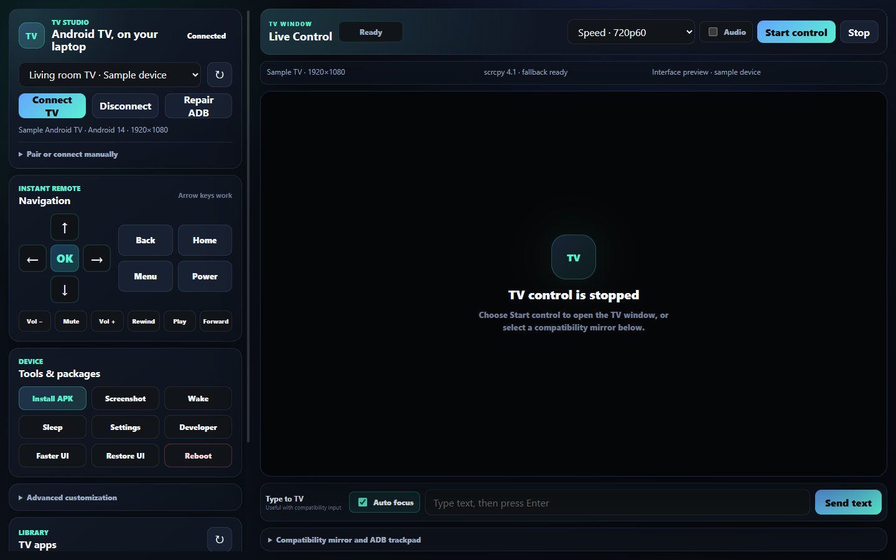

# TV Studio

[](https://github.com/lekshmikanthsudersen/tv-studio/actions/workflows/windows.yml)   [](LICENSE)

**Control your Android TV from a Windows desktop: live view, mouse and keyboard, screenshots, and APK installation in one place.**

TV Studio combines an Electron desktop interface with [Genymobile's scrcpy](https://github.com/Genymobile/scrcpy) for interactive video and input, plus ADB tools for managing a connected TV. The live TV screen opens in a normal companion window, while the main app keeps remote buttons, apps, and device tools close by.



*Interface preview rendered from the actual app UI with example device details. The live companion-window capture below is from a real Sony TV.*

## The problems it solves

| Everyday friction | TV Studio's approach |
| --- | --- |
| Typing with a TV remote is slow | Use your laptop keyboard in supported Android text fields. |
| Remote buttons, ADB commands, and APK installs are scattered | Keep navigation, application tools, and installation in one desktop interface. |
| Live input can trap the cursor or lose keyboard focus | Use a normal scrcpy window with a pointer that can leave freely. |
| Captures fail silently or pile up | Validate screenshots, show progress and errors, and keep one preview capture in flight. |
| Restarting control can leave stale processes behind | Wait for shutdown, cancel stale work, and clean up the sessions TV Studio owns. |

## What you can do

- Connect through wireless ADB pairing, device discovery, or a manual IP address.
- View and control the TV with your desktop mouse and keyboard.
- Use remote navigation, Home, Back, volume, playback, wake, and sleep buttons.
- Capture a PNG screenshot and open the saved image directly from the app.
- Select several APK files for installation, with progress and per-file results.
- Launch TV apps and inspect installed packages.
- Install a separate launcher APK and select its Home activity where the TV permits it.
- Use snapshot preview or a legacy H.264 stream as compatibility options.

TV Studio is a Windows desktop controller. It does not replace the TV's operating system. [Free My TV](https://github.com/simbasjungles/free-my-tv), which may appear in screenshots, is a separate, optional launcher and is not bundled with this project.

<details>
<summary>Explore the remote and device tools</summary>

<p>
  
  
</p>

These panels are rendered from the actual interface with example connection details and a sample screenshot filename.

</details>

## Why the live screen has its own window

The earlier version embedded scrcpy's native window inside Electron. On the tested Sony TV setup, that introduced pointer capture, focus and scaling problems, unreliable screenshots, and shutdown behavior that could leave an Android scrcpy server running.

Version 2.0.1 uses scrcpy's normal decorated window and absolute SDK mouse input. The pointer can leave the TV window freely. Keyboard and mouse input use scrcpy's persistent control connection. TV Studio manages the session, waits for the previous process to exit before restarting, and stops owned processes when the app closes.

The repair also fixes overlapping D-pad buttons, checkbox sizing, keyboard shortcuts interfering with form controls, asynchronous focus changes, and an unbounded queue of repeated ADB remote keys. Screenshot preview waits for each image to finish before requesting another and stops when live control starts.


*Actual scrcpy companion window connected to the Sony BRAVIA used for testing. Free My TV is the optional launcher visible on the TV; its app artwork belongs to the respective owners.*

## Run from source

Requirements: Windows 10 or 11, Node.js 22.12 or newer (Node.js 24 LTS recommended), and an Android TV with ADB debugging available. The TV and computer must be able to reach each other on the network.

```powershell
git clone https://github.com/lekshmikanthsudersen/tv-studio tv-studio
cd tv-studio
npm ci
npm run install:electron
npm run install:scrcpy:win
npm start
```

The installer downloads the official scrcpy 4.1 Windows archive and verifies its SHA-256 checksum. That archive also supplies the ADB runtime used by TV Studio.

FFmpeg is optional. Install it only if you want to try the legacy H.264 fallback:

```powershell
npm run install:ffmpeg:win
```

You can point the app at existing tools with `ANDROID_TV_CONTROLLER_ADB`, `ANDROID_TV_CONTROLLER_SCRCPY`, and `ANDROID_TV_CONTROLLER_FFMPEG`.

For a portable Windows build, keep the entire `TVStudio-win32-x64` folder together and run `TVStudio.exe` inside it.

## Connect your TV

Enable Developer options and debugging on the TV. The exact menu names depend on its manufacturer and firmware.

**If the TV offers Wireless debugging with a pairing code:**

1. Open the TV's **Pair device with pairing code** screen.
2. In TV Studio, expand **Pair or connect manually** and enter the TV IP, pairing port, and displayed code.
3. After pairing, return to the main Wireless debugging screen and use its connection port for **IP Connect**. The pairing port and connection port are different.
4. Select the TV and choose **Connect TV**. Live control starts automatically when scrcpy is available.

**If the TV already exposes classic ADB over the network:** use its IP and configured connection port, commonly `5555`, then accept the debugging authorization prompt on the TV. Entering `5555` does not enable network debugging by itself.

Manual IP connection works when the TV is reachable but multicast discovery is unavailable.

## Use live control

Click the **TV Studio Live** window to focus it. Move the pointer outside the window or use **Alt+Tab** to return to your desktop. Its title bar supports normal move, resize, and close behavior.

| Input | Action |
| --- | --- |
| Left mouse button | Click a supported Android touch target |
| Right mouse button | Back |
| Middle mouse button | Home |
| Arrow keys and Enter | Navigate TV interfaces |
| Keyboard typing | Enter text in the focused Android field |

Some TV interfaces support only remote navigation. In particular, Free My TV's painted Home and Settings menus use arrows and Enter; they do not implement mouse/touch handlers. Ordinary Android buttons and text fields can still accept clicks and typing.

| Profile | Maximum video dimension | Frame-rate ceiling | Video bitrate |
| --- | ---: | ---: | ---: |
| Speed — default | 1280 px | 60 FPS | 5 Mbps |
| Balanced | 1920 px | 60 FPS | 8 Mbps |
| Quality | 2560 px | 60 FPS | 14 Mbps |

These are requested encoder settings, not measured frame-rate or latency guarantees. Actual results depend on the TV, encoder, network, and computer. Changing quality or audio restarts the live session. Audio is off by default; forwarding is optional on compatible Android 11+ devices and was not part of the recorded hardware acceptance test.

## Screenshots and package tools

**Screenshot** shows capture progress, then the saved filename and an **Open image** button. Files are saved under the Windows Pictures folder in `AndroidTVController`. Capture errors are reported in the interface; some captures can take several seconds on the tested TV/network.

**Advanced customization** includes launcher selection and package actions. Disabling, removing for the current user, and clearing package data first save a JSON inventory under the Windows Documents folder in `AndroidTVController/backups`. These files record package and launcher metadata; they do not contain app data or provide a full device restore. The restore action re-enables packages listed as disabled in the selected backup.

Firmware flashing is outside this project's scope.

## Verification

The 2.0.1 repair was exercised on a **Sony BRAVIA VU3 running Android 14**. Recorded checks covered mouse clicks in Sony settings, arrows and Enter, typing into a TV field, Home, switching back to the desktop, saving/opening a screenshot, and closing/restarting live control without leaving an owned scrcpy server running.

Automated checks cover input and focus behavior, bounded command queues, screenshot validation, canceled startup, process cleanup, discovery, and renderer/IPC bindings. Layout checks passed at 1080×680 and 1440×900, with 100%, 125%, and 150% scaling and sections open or closed.

```powershell
npm run check
npm test
npm run smoke
npm run test:layout
```

The smoke test starts Electron. The layout test uses an isolated hidden renderer without connecting to a TV. Runtime contract checks require the ADB and scrcpy tools to be installed.

To create the portable Windows folder:

```powershell
npm run package:win
```

The result is `dist/TVStudio-win32-x64/TVStudio.exe`. The package includes scrcpy and ADB; legacy H.264 fallback requires a separately available FFmpeg runtime.

Detailed hardware observations, small-sample timings, and a real exported PNG are in [the validation notes](docs/validation.md).

## Known limits and troubleshooting

- **No TV found:** confirm debugging is enabled and both devices can communicate, then try manual IP connection.
- **Pairing succeeds but connection fails:** use the connection port, not the temporary pairing port, and accept any authorization prompt on the TV.
- **Clicks do nothing in one app:** focus the TV window and try arrows/Enter. Remote-only interfaces need remote navigation.
- **Protected playback appears black:** DRM content may not be capturable even when the Android interface mirrors correctly.
- **A screenshot is slow:** allow the current capture to finish; the app prevents overlapping preview captures and reports failures.
- **Legacy H.264 is unreliable:** use live control or snapshot preview. Firmware support for Android `screenrecord` varies.

Other TV models, prolonged network outages, audio forwarding, DRM playback, precise physical key-to-screen latency, and sustained frame rate were not covered by the recorded acceptance test.

## Credits

- [Genymobile scrcpy](https://github.com/Genymobile/scrcpy) provides the video, input, and optional audio engine. TV Studio builds a desktop workflow around that existing project. scrcpy is distributed under Apache-2.0; retain its notices and those of bundled runtimes.
- [Electron](https://www.electronjs.org/) provides the desktop application framework.
- [Ponytail](https://github.com/dietrichgebert/ponytail) informed the repair approach: trace the full flow, reuse native capabilities, make the smallest complete fix, and verify behavior on actual hardware.
- [Free My TV](https://github.com/simbasjungles/free-my-tv) is an independent optional launcher, credited separately from the controller.


## Contributing and license

Bug reports from other TV models are welcome. Include the TV model, Android version, connection method, and steps to reproduce; remove addresses, pairing codes, and personal content from logs and images. See [CONTRIBUTING.md](CONTRIBUTING.md).

TV Studio source is [MIT licensed](LICENSE). External runtimes keep their own licenses; see [THIRD_PARTY_NOTICES.md](THIRD_PARTY_NOTICES.md).
