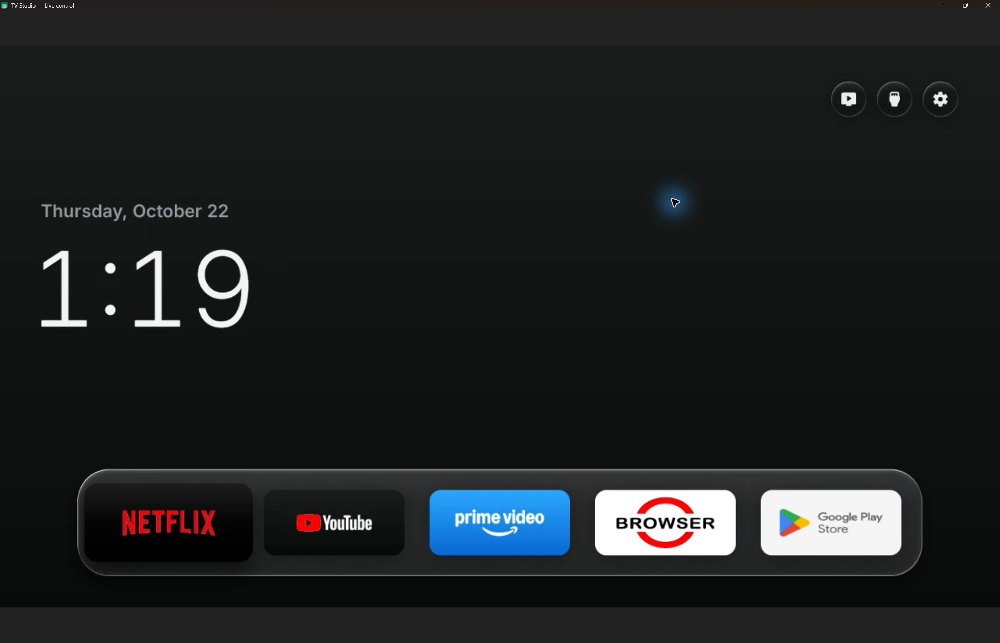
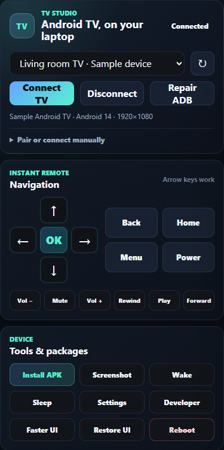
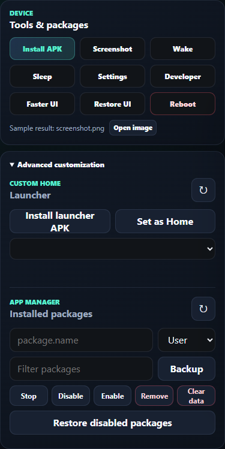

# TV Studio

**Control your Android TV from your Windows PC.**

Choose music, search in apps, browse the web, and switch what's on the TV with the keyboard and mouse already in front of you. TV Studio brings a live view of your TV to your desktop, alongside remote controls, screenshots, and app installation.

[Get started](#get-started) · [User guide](docs/usage.md) · [Report an issue](https://github.com/lekshmikanthsudersen/tv-studio/issues)

  

*Live control on a Sony BRAVIA. The TV is running the separate [Free My TV](https://github.com/simbasjungles/free-my-tv) launcher.*

## Make your TV easier to use

- **Music while you work.** Open a music app on the TV, search for something to play, pause it, or adjust the volume from your desk. Leave **Audio** off in TV Studio to keep listening through the TV's speakers or connected sound system.
- **A keyboard for TV searches.** Type a video title, artist, or web address instead of selecting each letter with the remote.
- **More comfortable browsing.** Use your computer's mouse and keyboard in the TV's browser. Follow links, enter searches, and navigate pages while seeing the TV screen on your desktop.
- **Quick app switching.** Open installed TV apps, return Home, or use Back and the directional controls without picking up another device.
- **Wake from your desk.** Remember your TV once, then use **Wake TV** even when it is offline. Network wake requires a supported TV with network standby enabled.
- **Your own TV setup.** Install APKs from your computer, try a custom launcher, and manage installed packages. Launcher selection depends on what your TV allows.
- **Screenshots when you need them.** Save the TV screen as a PNG to explain a setting, document a setup, or share an error.

Some TV apps are designed for directional navigation. Use the arrow keys and Enter when an app does not respond to mouse clicks.

Remote controls and device tools

  
  

*Interface previews with sample device details and a sample screenshot filename.*

[View the full desktop interface](docs/images/tv-studio-overview.png).

## Get started

You need **Windows 10 or 11 (x64)** and an Android TV with debugging available. Connect the TV and PC to the same local network.

### Run from source

Install Git and **Node.js 22.12 or newer**, then run:

~~~powershell
git clone https://github.com/lekshmikanthsudersen/tv-studio.git
cd tv-studio
npm ci
npm run install:electron
npm run install:scrcpy:win
npm start
~~~

### Connect your TV

1. Enable Developer options and debugging on the TV.
2. In TV Studio, select your TV or open **Pair or connect manually**. If the TV uses wireless pairing, enter its pairing details first, then connect using its connection port.
3. Accept the debugging prompt on the TV and choose **Connect TV**.

The live TV view opens in its own desktop window. Click that window to control the TV; keep the main window nearby for remote buttons, screenshots, and app tools.

See the [connection guide](docs/usage.md#connect-your-tv) for pairing and manual IP setup.

## Everyday controls

| Input | Action |
| --- | --- |
| Mouse click | Select items in apps that support mouse/touch input |
| Arrow keys + Enter | Navigate TV menus and select an item |
| Right mouse button | Back |
| Middle mouse button | Home |
| Keyboard | Type into the TV's focused text field |

Use **Alt+Tab** or click another window to return to your work. The main window also provides volume, mute, playback, Home, and Back buttons.

## Compatibility

Tested on a **Sony BRAVIA VU3 running Android 14**. Input support varies between TV apps, and protected video may appear black in the live view. Network quality and the TV's hardware affect responsiveness.

For music through the TV, keep **Audio** off. That option forwards sound to the PC when enabled on supported devices; it is not needed to control playback on the TV.

See the [user guide](docs/usage.md) for screenshots, APKs, launchers, display quality, and troubleshooting.

## Contributing

Reports from other TV models are welcome. Include your model, Android version, and steps to reproduce the issue. For local checks and building a portable Windows folder, see [CONTRIBUTING.md](CONTRIBUTING.md).

## Credits and license

TV Studio uses [scrcpy](https://github.com/Genymobile/scrcpy) for live display and input, [ADB](https://developer.android.com/tools/adb) for device tools, and [Electron](https://www.electronjs.org/) for the desktop app.

The source is [MIT licensed](LICENSE). External components retain their own licenses; see [THIRD_PARTY_NOTICES.md](THIRD_PARTY_NOTICES.md). Free My TV is shown in the screenshots and is not included with TV Studio.
