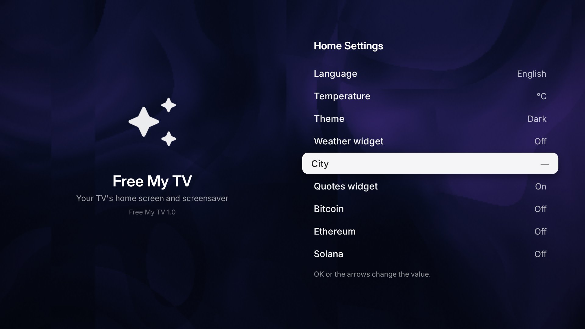

# Using TV Studio

[Back to the README](../README.md)

## Connect your TV

Keep the TV on and connect it to the same local network as your PC. Enable Developer options and debugging in the TV's settings; menu names vary by manufacturer.

### Wireless debugging with a pairing code

1. On the TV, open **Wireless debugging → Pair device with pairing code**.
2. In TV Studio, expand **Pair or connect manually**. Enter the TV's IP address, pairing port, and code, then choose **Pair TV**.
3. Return to the TV's main Wireless debugging screen. Enter its connection port in TV Studio and choose **IP Connect**. The pairing port and connection port are different.
4. Select the TV and choose **Connect TV**. Accept a debugging authorization prompt on the TV if one appears.

### TVs with classic network debugging

If your TV already exposes ADB over the network, enter its IP address and configured connection port, commonly `5555`, then choose **IP Connect**. Accept the authorization prompt on the TV.

Entering port `5555` does not enable debugging. Some TVs need a manufacturer-specific setup before they accept network connections.

Use **Scan for TVs** to refresh discovery. Manual IP connection is useful when a reachable TV does not appear in the list.

## Control the TV

The live view opens in a separate window. Click it to send mouse and keyboard input to the TV. Resize or move it like any other desktop window, and use **Alt+Tab** to switch back to your work.

| Input | Action |
| --- | --- |
| Left click | Select a supported mouse/touch target |
| Arrow keys and Enter | Navigate menus and select an item |
| Right click | Back |
| Middle click | Home |
| Typing | Enter text into the focused Android field |

The main window provides a directional pad, Home, Back, volume, mute, playback controls, and installed apps. Choose an app in **TV apps** to open it on the TV.

Mouse support depends on the TV app. For example, Free My TV's Home and Settings menus use arrows and Enter. This does not prevent mouse input in other apps.

## Play music through the TV

Open your preferred music app on the TV, then use the live window to choose what to play. Use the app's playback controls or TV Studio's remote buttons for playback and volume; support for media buttons depends on the app.

Leave **Audio** unchecked to keep sound on the TV or its connected sound system. Audio forwarding is off by default. Enabling it sends sound to the PC on supported Android 11+ devices and may stop sound playing on the TV. See [scrcpy's audio documentation](https://github.com/Genymobile/scrcpy/blob/v4.1/doc/audio.md) for platform behavior.

## Browse and search

Open a browser or a search field on the TV. Click the field, type with your computer's keyboard, and press Enter. If the app expects a TV remote, use arrows and Enter to focus the field first.

TV Studio controls the apps already on your TV. Install a TV-compatible browser or music app if you do not have one.

## Save a screenshot

Choose **Screenshot** in the main window. When the capture finishes, use **Open image** to view the saved PNG. Images are saved in `Pictures/AndroidTVController`.

Captures can take several seconds, depending on the TV and connection. Protected content may be blank.

Example of a saved TV screenshot

*An actual TV Studio capture. The screen shown belongs to the separate Free My TV launcher.*

## Install apps and custom launchers

Choose **Install APK**, select one or more APK files from your computer, and follow the installation progress. The app reports a result for each file. APKs must be compatible with your TV.

For a launcher, expand **Advanced customization**, choose **Install launcher APK**, then select it from the launcher list and choose **Set as Home**. Some TVs open a system selection screen or restrict changes to the default launcher.

The package tools can inspect, stop, enable, disable, remove for the current user, or clear app data. Clearing data deletes that app's settings and stored data on the TV.

Before disabling, removing, or clearing a package, TV Studio saves a JSON package inventory in `Documents/AndroidTVController/backups`. This records package and launcher information, not app data. **Restore disabled packages** re-enables packages listed as disabled in that inventory; it cannot recover cleared app data.

## Display quality

Start with **Speed**. Try **Balanced** or **Quality** if you want a sharper image and your TV and connection can handle it.

| Profile | Maximum video dimension | Frame-rate limit | Video bitrate |
| --- | ---: | ---: | ---: |
| Speed | 1280 px | 60 FPS | 5 Mbps |
| Balanced | 1920 px | 60 FPS | 8 Mbps |
| Quality | 2560 px | 60 FPS | 14 Mbps |

These are requested settings; actual frame rate and response time vary. Changing quality or audio restarts the live window.

## Troubleshooting

| Problem | Try this |
| --- | --- |
| TV is missing from the list | Confirm debugging is enabled and both devices can communicate. Try manual IP connection. |
| Paired, but cannot connect | Use the connection port, not the temporary pairing port. Check the TV for an authorization prompt. |
| Mouse clicks do nothing in one app | Focus the live window. Use arrows and Enter for apps designed around a remote. |
| Sound moved from the TV to the PC | Uncheck **Audio** in TV Studio. |
| Live view feels slow | Choose **Speed** and check the local network connection. |
| A video appears black | The app may protect its video from screen capture. |
| Live control is unavailable | Try the snapshot option under **Compatibility mirror and ADB trackpad**. |

For further help, [open an issue](https://github.com/lekshmikanthsudersen/tv-studio/issues) with your TV model, Android version, and steps to reproduce the problem. Remove pairing codes, addresses, and personal content from anything you share.
